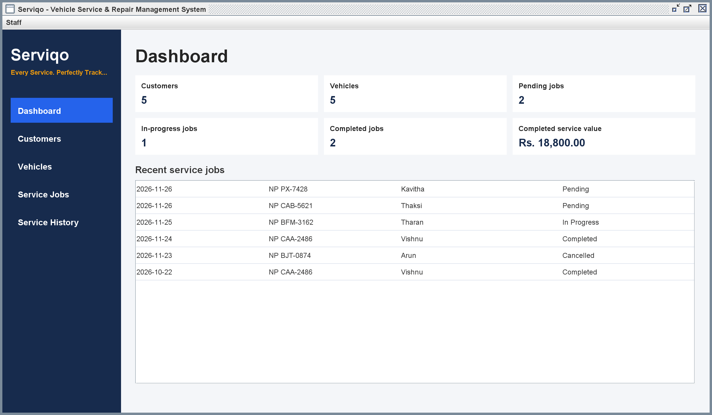
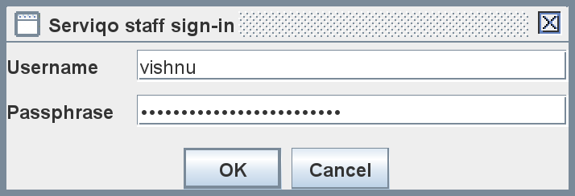
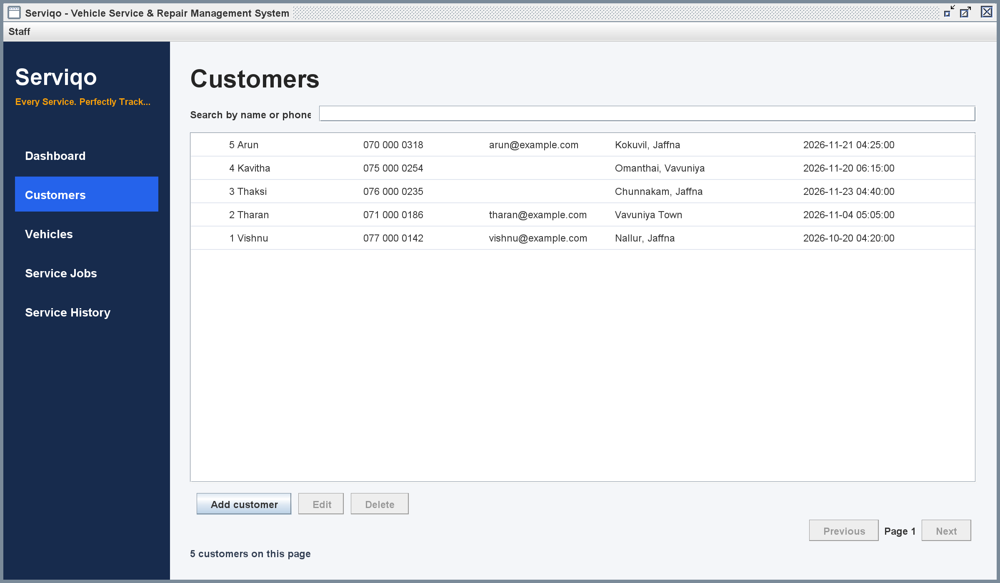
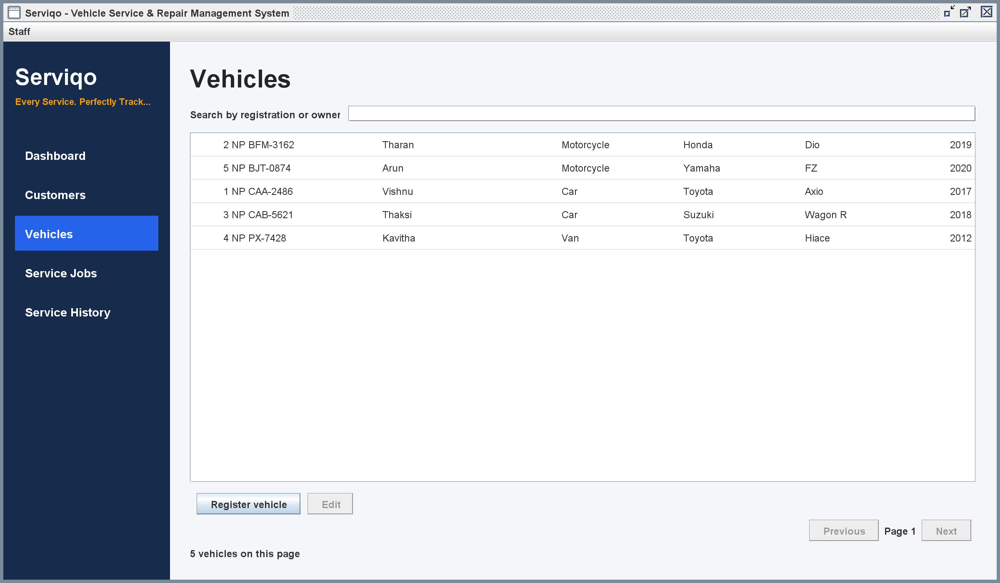
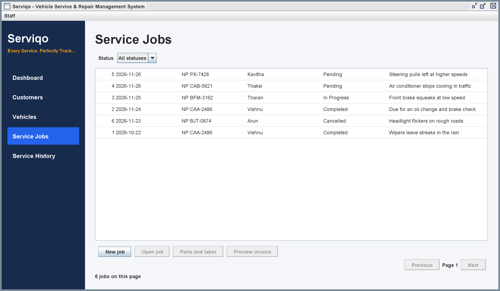
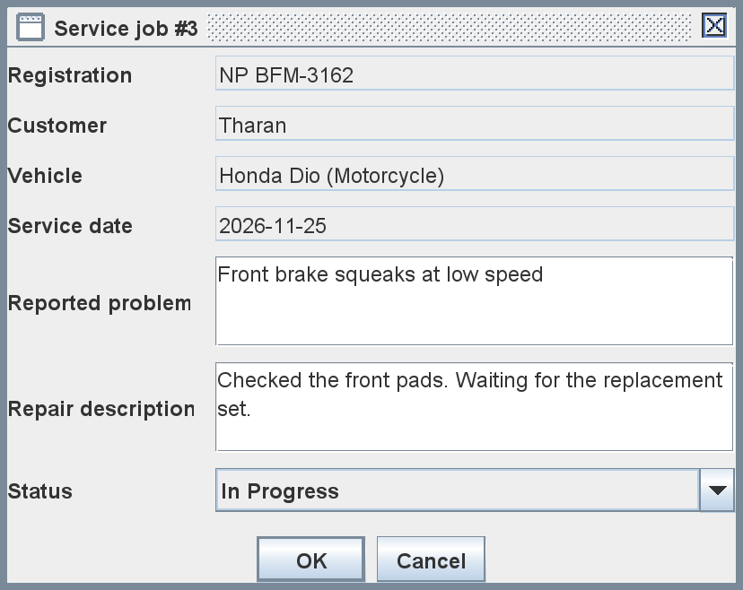
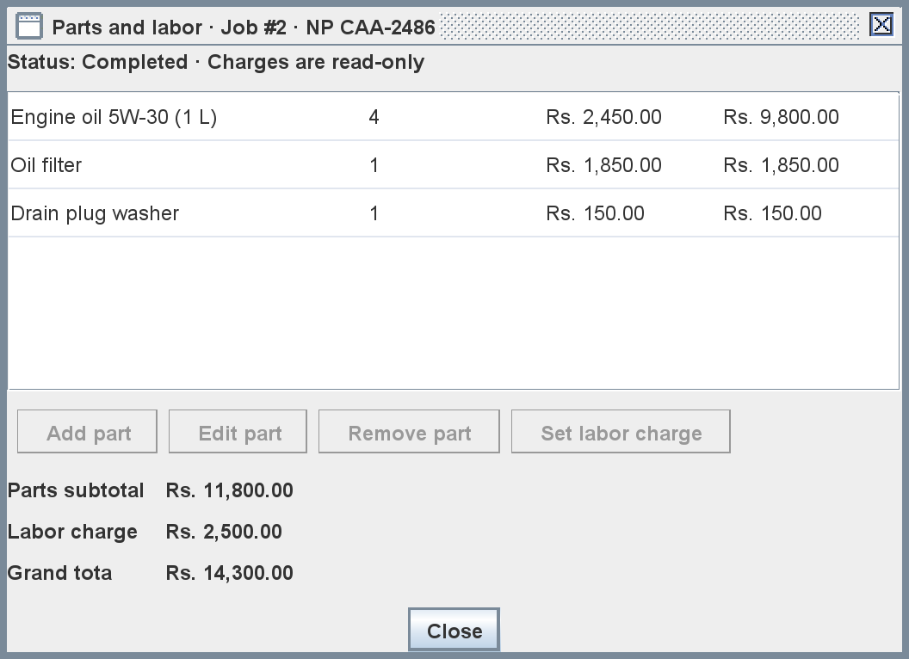
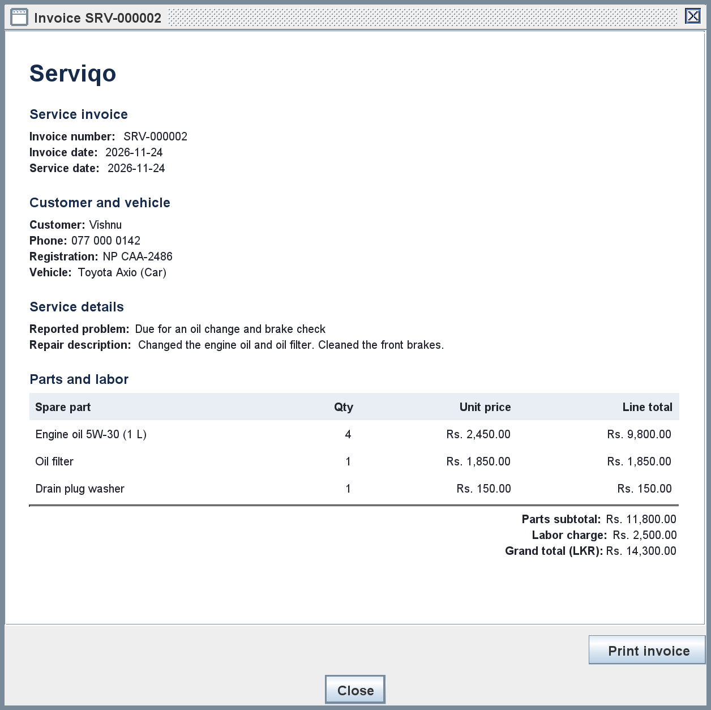
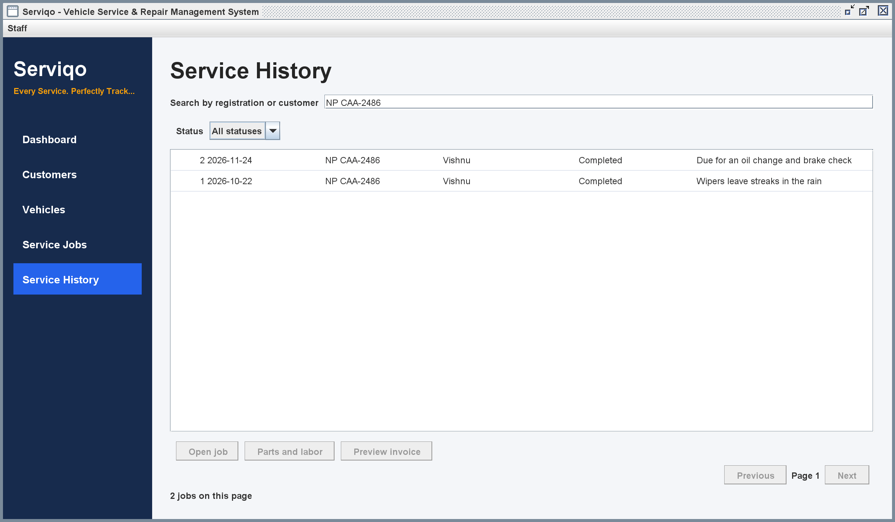

# Serviqo

Serviqo is a Java desktop application for vehicle service and repair workshops. It stores customers, vehicles, service jobs, and repair charges in SQLite. The dashboard summarizes workshop activity, and staff can search service history and print invoices for completed jobs.

## Screenshots

The screenshots show a workshop using fictional records from Jaffna and Vavuniya. Click any image to view it at full size.

[](docs/screenshots/02-dashboard.png)

| Staff sign-in | Customers |
| --- | --- |
| [](docs/screenshots/01-login.png) | [](docs/screenshots/03-customers.png) |

| Vehicles | Service jobs |
| --- | --- |
| [](docs/screenshots/04-vehicles.png) | [](docs/screenshots/05-service-jobs.png) |

| Job details | Parts and labor |
| --- | --- |
| [](docs/screenshots/06-job-details.png) | [](docs/screenshots/07-parts-and-labor.png) |

| Invoice preview | Service history |
| --- | --- |
| [](docs/screenshots/08-invoice.png) | [](docs/screenshots/09-service-history.png) |


## Run on Windows

Install JDK 21 and Apache Maven. Open this project folder in VS Code and use its PowerShell terminal, or open PowerShell directly in the project folder. Check the setup with `java -version`, `javac -version`, and `mvn -version`. Maven should report Java 21.

```powershell
mvn compile dependency:copy-dependencies
java -cp 'target/classes;target/dependency/*' com.serviqo.Main
```

Maven downloads the build plugins and SQLite JDBC driver on the first build. After building, use the second command to launch Serviqo without internet access.

## Database storage and upgrade

Serviqo opens `%LOCALAPPDATA%\Serviqo\serviqo.db` on Windows. The working directory does not select the database. Serviqo checks the Windows access rules before opening it and stops startup if the directory or database grants access to other ordinary accounts.

If you already have a database from an older version, close all old Serviqo instances and import the database **before the first regular launch**. Run this from the project folder in PowerShell and replace the sample path with the absolute path of your trusted copy:

```powershell
java -cp 'target/classes;target/dependency/*' com.serviqo.Main --import-legacy 'C:\path\to\old\serviqo.db'
```

The import takes a SQLite snapshot, checks it, and leaves the original file in place. Import refuses to overwrite a database at the new location. If one already exists, keep both databases and back them up before deciding which to use.

The SQLite database format is unencrypted. For encryption at rest, enable [Windows Device Encryption](https://support.microsoft.com/en-us/windows/security/encryption/device-encryption-in-windows) or BitLocker on the drive holding the database, and verify that protection is active. Keep the recovery key in a safe location and keep old database copies and backups on encrypted storage too. The drive protection complements Windows file permissions and Serviqo staff sign-in.

## Staff accounts

On the first launch for a database, the workshop owner creates the first **Manager** account and then signs in. Use a unique passphrase of 15 to 128 characters. Existing workshop records stay in place. Each separate demo database has its own staff accounts.

| Role | Access |
| --- | --- |
| Manager | Customers, vehicles, all service actions, charges, invoices, staff account creation, and the recent audit log. |
| Mechanic | Workshop job counts, vehicle selection for new jobs, service history, repair descriptions, and starting pending jobs. |

A manager can open **Staff → Add staff account** to create an individual account. Use **Staff → Sign out** before handing the workstation to someone else. The database stores salted PBKDF2-HMAC-SHA256 password hashes. **Staff → View audit log** shows the latest 200 entries with the staff username, UTC timestamp, action, and affected record ID. Changes and their audit entries are saved in the same transaction.

Staff permissions apply inside Serviqo. Windows account permissions control direct access to the SQLite file and audit records.

## How it works

`Main.java` starts the application and uses Swing's `CardLayout` to switch screens inside one window. `Database.java` creates the tables in one transaction and enables foreign keys for every connection. The links between tables prevent deleting a parent record while another record still refers to it.

## Manage customers

1. Open **Customers** and click **Add customer**. Enter a full name and phone number. Email and address are optional. Saved customers appear in the table with their ID and registration date in UTC.
2. Search by name, part of the phone number, or the customer ID. Clear the search field to show the unfiltered list. Use **Previous** and **Next** to browse results.
3. Select a row, click **Edit**, and save a change. Close and reopen Serviqo to verify that it was saved.
4. Try saving with a blank name, an invalid phone number, or an incomplete email address. The form should show a validation message and let you correct the field.
5. Select a customer, click **Delete**, and confirm. A customer with a registered vehicle is protected from deletion.

`CustomerPanel.java` handles the customer table, search, and forms. `CustomerRepository.java` uses prepared statements to load and save customer records in SQLite.

## Manage vehicles

1. Add the owner in **Customers**. Open **Vehicles**, click **Register vehicle**, and use **Choose owner** to search and select the customer.
2. Enter the registration number, vehicle type, brand, and model. The manufacturing year and notes are optional. Save and check that the table shows the vehicle and its owner.
3. Search by part of the registration number or owner name. Select a row and click **Edit** to update the vehicle.
4. Try registering the same plate using lowercase letters. The app should report that the registration number is already in use.
5. Reopen Serviqo and check that the vehicle and its changes are still present. In **Customers**, confirm that the owner is protected from deletion while the vehicle is registered.

`VehiclePanel.java` handles the vehicle form, owner selection, and table. `VehicleRepository.java` reads the owner's name from the linked customer record and uses prepared statements to save vehicle details.

## Manage service jobs

1. Register a customer's vehicle. Open **Service Jobs**, click **New job**, then search for and select the registered vehicle. The form shows the linked customer and vehicle details.
2. Enter the reported problem and a service date in `YYYY-MM-DD` format. The repair description is optional. Save the job and confirm it appears as **Pending**.
3. Select the job and click **Open job** to edit the repair description or change the status. Set the job to **In Progress** before marking it **Completed**.
4. A **Pending** or **In Progress** job can be marked **Cancelled**. Completed and cancelled jobs are read-only. Serviqo asks for confirmation before closing either way.
5. Use the **Status** filter to show jobs in a particular state. Reopen Serviqo to confirm that the job, repair description, and status are still saved.

`ServicePanel.java` handles the service job forms and table. `ServiceRepository.java` saves jobs and enforces the status transitions.

## Record parts and labor

1. Select a job in **Service Jobs** and open **Parts and labor**. Charges can be changed while a job is **Pending** or **In Progress**.
2. Click **Add part** and enter a name, a positive whole-number quantity, and a unit price in LKR. Use **Edit part** or **Remove part** to change a saved line.
3. Click **Set labor charge** to record labor in LKR. Prices and charges accept up to two decimal places.
4. Check the calculated line totals, parts subtotal, labor charge, and grand total. For example, two units of engine oil at Rs. 2,000.00 each, one oil filter at Rs. 1,500.00, and Rs. 2,500.00 for labor should total Rs. 8,000.00.
5. Close and reopen the job to confirm the charges were saved. After completing or cancelling the job, reopen **Parts and labor** to view the saved charges in read-only mode.

## Preview and print invoices

1. In **Service Jobs**, select a **Completed** job and click **Preview invoice**.
2. Check the invoice number, invoice date, customer name and phone, vehicle details, repairs, parts, and charges. For example, job 123 always uses invoice number `SRV-000123`. The invoice date comes from the saved UTC completion date, with the service date used for older jobs without a completion timestamp.
3. Click **Print invoice** to open the Windows print dialog. Choose your printer or **Microsoft Print to PDF** if it is installed.
4. Select a pending, in-progress, or cancelled job and confirm that **Preview invoice** is disabled.

`InvoicePrinter.java` builds the preview from the saved job and sends it to the selected printer through Java's built-in printing support.

## Find past service jobs

1. Open **Service History**. Jobs are listed by most recent service date first.
2. Enter all or part of a registration number or customer name. Use the **Status** filter to narrow the results further. Choose **All statuses** and clear the search to show every job again.
3. Select a row and click **Open job** for the original problem and recorded repair. Click **Parts and labor** for quantities, prices, and totals.
4. Click **Preview invoice** to reopen the invoice for a completed job. Use **Service Jobs** to update active records.

## Check the dashboard

1. Open **Dashboard** to see customer and vehicle counts, job counts by active and completed status, and up to eight recent service jobs.
2. Complete a job with saved parts and labor, then return to **Dashboard**. The completed job count and completed service value should reflect the change. Pending, in-progress, and cancelled jobs do not contribute to the completed service value.
3. Resize the window down to its minimum size and check that the sidebar, statistics, and recent jobs table remain accessible.

## Demo workflow

Use the separate demo database for this exercise. After building the project, run the following from the project folder in PowerShell. The first demo launch creates a fresh database under `%LOCALAPPDATA%\Serviqo\demo`. Repeat the command to reopen it.

```powershell
java -cp 'target/classes;target/dependency/*' com.serviqo.Main --demo
```

| Screen | Sample records |
| --- | --- |
| Customers | Nila Perera, 0770000123 |
| Vehicles | DEMO-1234, Motorcycle, Honda Dio, 2020 |
| Service Jobs | Today's date, reported problem **Oil leak near the engine**, repair **Replaced the seal and changed the engine oil** |
| Parts and labor | Engine oil, 2 × Rs. 2,000.00. Oil filter, 1 × Rs. 1,500.00. Labor, Rs. 2,500.00. |

1. Set up the first demo manager and sign in. Create the records in order and check that the job starts as **Pending**. Set it to **In Progress** while recording the charges, then mark it **Completed**.
2. Open the invoice and check the **Rs. 8,000.00** grand total. Use the print dialog to print or select **Microsoft Print to PDF** if available.
3. In **Service History**, search for `demo-1234` and filter by **Completed**. Confirm that the repair, charges, and invoice can be reopened.
4. Try adding a customer with a blank name or using a duplicate registration. Try a part quantity of zero and a negative price on a separate active job. Each entry should be rejected. Try deleting Nila in **Customers** and confirm that her registered vehicle protects the record.
5. Close and reopen the demo. Check that the records still appear and **Dashboard** shows one completed job worth **Rs. 8,000.00**. Check that every sidebar button opens the page it names.

## Troubleshooting

- **Maven command is missing.** Add Maven's `bin` directory to Windows `PATH` and reopen the terminal, or run `mvn.cmd` directly from that directory using its full path.
- **Maven uses a different Java version.** Check that `JAVA_HOME` points to JDK 21 and that `mvn -version` reports the expected JDK.
- **Database startup failed.** Check the terminal message and the permissions on `%LOCALAPPDATA%\Serviqo`. Keep a backup before repairing or replacing a database.
- **Database is busy.** Serviqo waits up to about five seconds for another instance to release a write lock. If it is still busy, wait for the other operation to finish, then retry your action.
- **Print failed.** Confirm that a printer or virtual printer is installed and try printing the invoice again from its preview.

## Record limits

Customer, vehicle, service job, and service history lists display up to 50 results per page. Searches and status filters apply to the whole database before paging.

| Field | Maximum characters |
| --- | ---: |
| Customer name, part name | 120 |
| Phone number, vehicle type | 40 |
| Email | 254 |
| Address | 300 |
| Registration number | 32 |
| Vehicle brand or model | 80 |
| Vehicle notes | 1,000 |
| Reported problem | 500 |
| Repair description | 2,000 |

The forms and database enforce these limits on new values. Existing text is retained during an upgrade. If a form flags an older value when saving, shorten it to the stated limit. A service job can display and print up to 500 part lines. Serviqo refuses to display or invoice an older job beyond that limit so it cannot show a partial total.

SQLite also requires a vehicle brand, model, and supported type, and a real service date in `YYYY-MM-DD` format. The upgrade preserves old records and enforces these rules when affected fields are added or changed.
